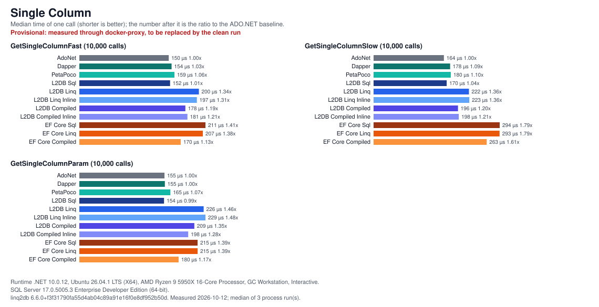
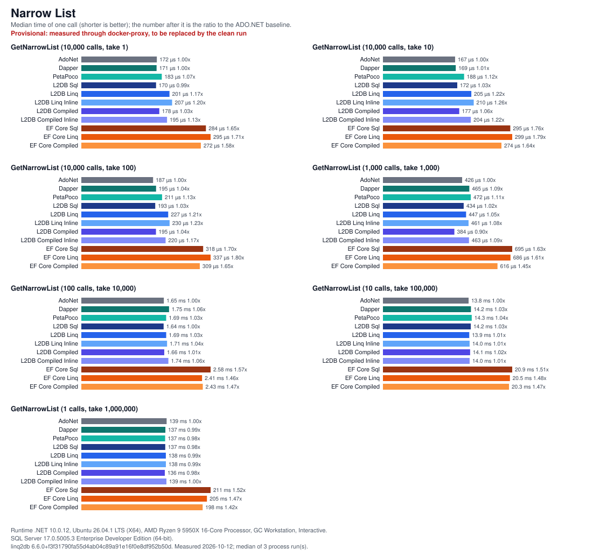
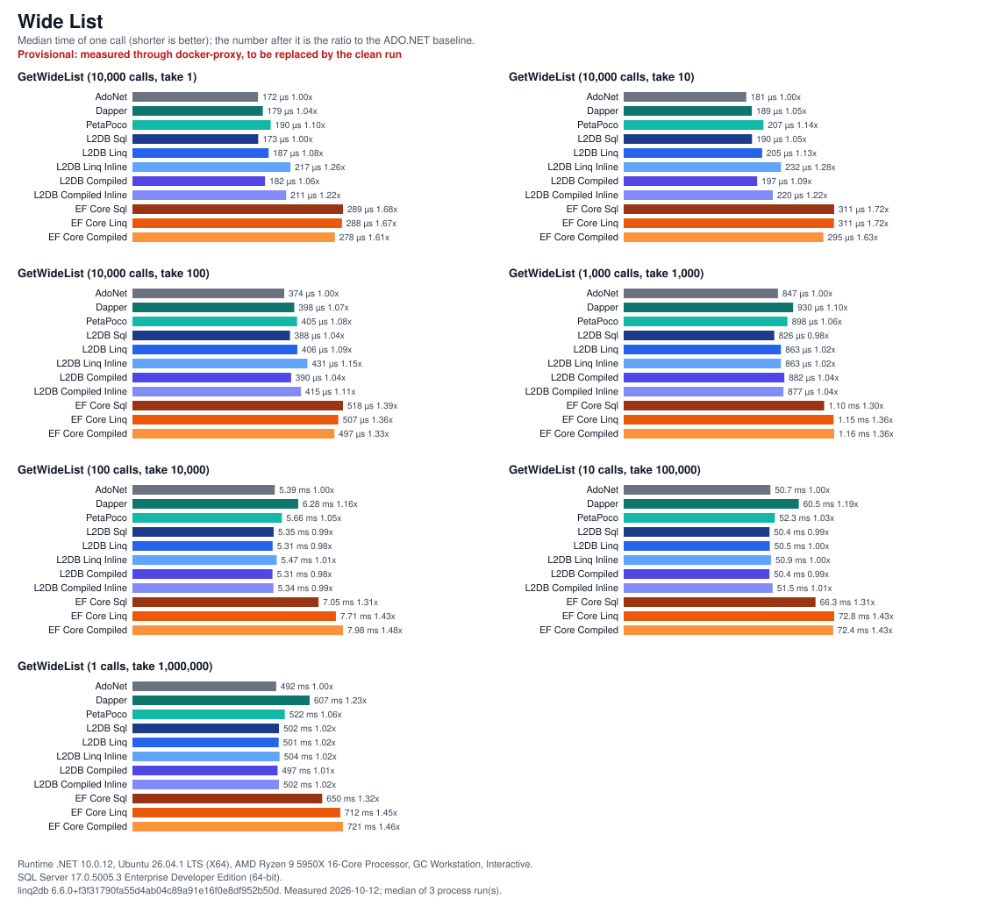
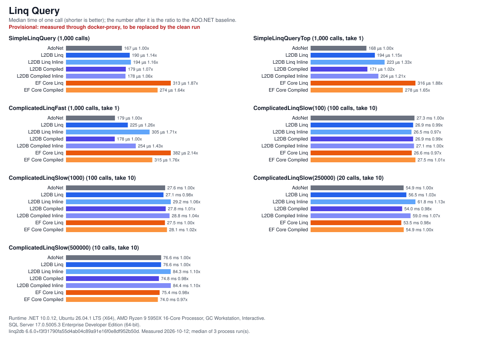

# linq2db PerformanceTest

Compares linq2db with plain ADO.NET and other data access libraries on SQL Server, and tracks
linq2db's own performance over time. linq2db is built from source: the solution expects a linq2db
checkout next to this repository (`../linq2db`).

Libraries: ADO.NET (baseline, in two variants: "AdoNet" and "AdoNet Param"), linq2db (Sql, Linq, Linq Inline, Compiled, Compiled Inline), EF Core
(Sql, Linq, Compiled), Dapper, PetaPoco; on .NET Framework 4.8 also EF6, LINQ to SQL and BLToolkit.
Target frameworks: `net10.0` and `net481`.

## Running

```
dotnet build ConsoleRunner/ConsoleRunner.csproj -c Release
dotnet ConsoleRunner/bin/Release/net10.0/ConsoleRunner.dll [--connection "<connection string>"] [--group "<group name>"] [perform]
```

`--group` runs one test group only, for example `--group "Single Column"`; an unknown name lists the
groups and exits with code 2. Option names are case-insensitive. Any other argument is an error
(exit code 2), and arguments are never printed, since the connection string may hold a password.
`RunAll.cmd` builds the solution and runs both frameworks five times, interleaved.
`UI.cmd` starts the WPF viewer for `Result/Result.sqlite`.

The SQL Server connection string is taken from, in this order:

1. `--connection "<value>"` or `--connection=<value>`;
2. the `PERFTEST_CONNECTION_STRING` environment variable;
3. `Server=.;Database=PerformanceTest;Trusted_Connection=True;TrustServerCertificate=True;`.

The database named in it is created and filled on the first run (two tables of one million rows).
The test marks a database it creates (table `PerformanceTestOwner`) and drops and recreates only a
marked database whose data is out of date. An existing unmarked database is used as is when it holds
the current test data (as databases from earlier versions of this test do); otherwise the run stops
without changing it.

## Results

**Provisional: measured through docker-proxy, to be replaced by the clean run.** The charts below come
from three back-to-back processes of one Linux run (net10.0, SQL Server 2025 in a Docker container on the same
machine, reached through docker-proxy rather than the host network). The proxy adds latency to every
round trip, which compresses the differences between libraries in the call-bound tests. This run predates
"AdoNet Param", so that column is absent.

Each chart is one test group. A panel is one test method (calls and row limit in its title); a bar is the
median time of one call over the processes, and the number after it is the ratio to the "AdoNet" baseline of
the same panel. Every panel has its own scale. The environment (runtime, OS, CPU, SQL Server, linq2db
version, date) is printed under each chart.

[](Charts/single-column.svg)
[](Charts/narrow-list.svg)
[](Charts/wide-list.svg)
[](Charts/linq-query.svg)

Raw results: [`Charts/Result.sqlite`](Charts/Result.sqlite) (every sample and the environment of each run).
The charts are generated from it; `Charts/note.txt` is the provisional label printed on them (delete it for
a final set):

```
dotnet run --project ChartTool -c Release -- Charts/Result.sqlite Charts
```

The tool takes the platform of the newest run (or `--platform "NET 10.0"`), pools the runs with an
identical environment and library versions, and writes one SVG per group. The output depends only on the
data, so the same database gives byte-identical files.

## Method

- **Same work for everyone.** Every library runs the same query and reads every row it returns.
  List tests stream: rows are enumerated one by one and discarded, nobody builds a `List<T>`
  (Dapper uses `buffered: false`). The one exception is "BLToolkit Sql" (.NET Framework only), whose
  raw-SQL API fills a list (`ExecuteList`). Single-value tests read the value. `SimpleLinqQuery`
  reads the first row of an unlimited query and stops, for every library including the ADO.NET
  baseline; `SimpleLinqQueryTop` limits the query on the server instead and reads all it returns.
  "LoWcf Linq" (linq2db over WCF, .NET Framework only, off by default) cannot stop early: the service
  reads and sends the whole result before the client sees the first row, so in `SimpleLinqQuery` it
  transfers every row.
- **Same query shape.** The LINQ and compiled variants of every library run the same query.
  Single-value tests call `First()` (`FirstAsync()` in the async tests) on the query, so the
  library asks the server for one row (`TOP (1)`); list and LINQ query tests enumerate the query.
  Raw-SQL providers run the fixed SQL text (`SELECT ID FROM Narrow WHERE ID = 1`).
- **Idiomatic settings.** Change tracking is off unless a test asks for it (EF Core and EF6
  `NoTracking`, LINQ to SQL `ObjectTrackingEnabled = false`). EF Core contexts share one prebuilt
  `DbContextOptions`; context pooling is not used, because linq2db creates a plain `DataConnection`
  per context too. Compiled queries are measured separately where the library has them; they are
  held in static fields and compiled once per process, as an application keeps them, so their
  translation happens during warmup and never inside a timed run.
- **linq2db configuration.** The main linq2db providers run with the library defaults
  (`InlineParameters = false`, `ParameterizeTakeSkip = true`): captured values and Take/Skip go to
  the server as parameters. "L2DB Linq Inline" and "L2DB Compiled Inline" run the LINQ and the
  compiled tests with `InlineParameters = true` and `ParameterizeTakeSkip = false`, which put these
  values into the SQL text; they are there for comparison only. "LoWcf Linq" uses the library
  defaults on both sides. Earlier runs measured the main providers with the inline configuration;
  the row "linq2db settings" in `TestRunInfo` records which one a run used.
- **ADO.NET baseline in the LINQ query tests.** The hand-written SQL of `ComplicatedLinqFast` and
  `ComplicatedLinqSlow` passes Take/Skip and the row limit as parameters, as linq2db's default
  configuration does, and keeps the constants of the query as literals, as linq2db does too.
  (`SimpleLinqQueryTop` has always passed its row count as a parameter.) Results of the two
  complicated queries recorded before this change used literal values in the baseline (matching the inline configuration then used by the main
  linq2db providers), so their "AdoNet" column is not comparable across that change.
  The list tests keep the fixed SQL (`TOP (<n>)` as a literal) that all raw-SQL providers run.
- **Two ADO.NET baselines.** linq2db's default configuration sends `Take` as a parameter, so in the list
  tests (Narrow List, Wide List) "L2DB Linq" and "L2DB Compiled" run `TOP (@take)` while the raw-SQL
  providers run `TOP (<n>)` with a literal. "AdoNet" keeps the literal and is the floor for the raw-SQL
  providers; "AdoNet Param" runs the same reader loop with `TOP (@take)` as an `Int` parameter and is the
  floor for the linq2db variants that parameterize. The other tests need no second variant: the single-value
  and LINQ query baselines already pass parameters wherever linq2db does. Runs recorded before "AdoNet Param"
  existed have no such column.
- **Connection pools.** Every library uses its own `Application Name`, and so its own pool. The
  variants of one library share it: all linq2db providers use one pool, all EF Core providers another.
- **Warmup.** Before each timed run the same method runs with the same repeat and take counts until
  one second has passed (at most ten runs), so tiered JIT, caches and pools have settled.
- **Timing.** One timed run per test, provider and process, measured with `Stopwatch.Elapsed`.
  Providers run in random order within a process. Repeat the process (as `RunAll.cmd` does) to get
  several samples; the viewer shows a trimmed mean.

## Result data

`Result/Result.sqlite` holds every sample (`TestRun` → `TestMethod` → `TestStopwatch`, times as
`TimeSpan` ticks) and, per run, `TestRunInfo`: runtime, OS, CPU, GC mode, build configuration,
library versions (linq2db with its commit), linq2db settings, warmup rule and SQL Server version.
`Result/<platform>.<group>.txt` holds the last run's table.

Tick units: runs with `TestRunInfo` rows store `TimeSpan` ticks (100 ns; the row "Tick unit" says
so, "Stopwatch frequency" records the timer). Older runs have no `TestRunInfo` rows and stored raw
`Stopwatch` ticks. All of them were recorded on Windows, where the `Stopwatch` frequency is 10 MHz,
so their ticks are `TimeSpan` ticks too and the viewer shows them as such. An old run made on Linux
(1 GHz timer, 100x larger values) cannot be told apart by the viewer: delete such runs.

`Result.sqlite` is never deleted or replaced by the test. If it cannot be opened or has another
version, the run stops and asks to move the file away; a new one is created on the next run.
